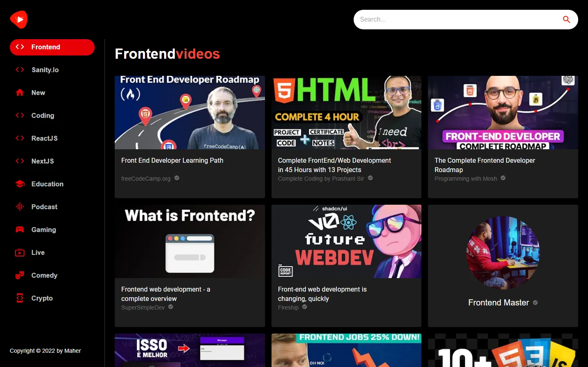

# Tuby

A React + TypeScript app for browsing YouTube video data through RapidAPI, built to stay fast as content grows.

**[Live demo](https://devmaheremad.com/tuby/)** · [More of my work](https://devmaheremad.com)



## What's inside
- **Performance.** Route-level code splitting: the home, video and channel pages load with `React.lazy` and
  `Suspense`, so each page downloads only the code it needs, with a loader while it arrives.
- **State.** One small Zustand store holds the selected category, the video list, the current video, related videos
  and the channel data.
- **Pages.** A home feed by category, search results (`/search/:searchTerm`), a video page with an embedded player
  (`react-player`) and related videos, and a channel page with its videos.
- **Data.** RapidAPI (YouTube v3) through one typed `fetchFromRapidAPI` helper; the API key comes from the environment.
- **UI.** Material UI 5 with a custom theme and responsive layouts.

## Stack
React 18 · TypeScript · Zustand · Material UI 5 · React Router 6 · react-player · RapidAPI

## Run locally
```bash
git clone https://github.com/devmaheremad/tuby.git
cd tuby
npm install
npm start
```

Create a `.env` file in the project root with your own RapidAPI key (never commit it):

```
REACT_APP_RAPID_API_KEY=your-rapidapi-key
```

---

**Maher Almashharawi** · Senior Frontend Engineer (React, Next.js, TypeScript)
[devmaheremad.com](https://devmaheremad.com) · [Case studies](https://devmaheremad.com/case-studies/) · [LinkedIn](https://www.linkedin.com/in/devmaheremad) · hello@devmaheremad.com
